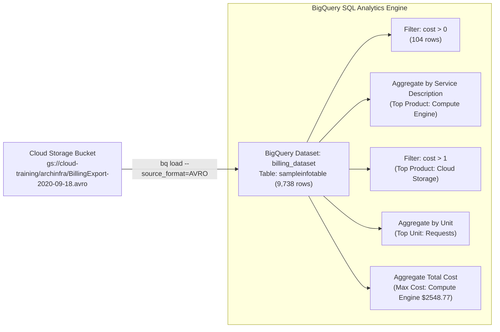

# Examine Billing data with BigQuery (CBL009)

[](https://cloud.google.com/)
[](https://cloud.google.com/bigquery)
[](https://cloud.google.com/storage)
[](https://avro.apache.org/)
[](LICENSE)

Comprehensive automated solution, verification script, SQL query library, and documentation for the Google Cloud Skills Boost lab: **Examine Billing data with BigQuery (CBL009)**, part of the **Essential Google Cloud Infrastructure: Core Services** course in the **Google Cloud Engineering Certificate** pathway.

---

## 📌 Lab Overview

* **Course:** Essential Google Cloud Infrastructure: Core Services
* **Badge / Pathway:** Google Cloud Engineering Certificate
* **Lab ID:** `CBL009`
* **Target Environment:** BigQuery, Google Cloud Storage, Cloud Shell
* **Duration:** 30 minutes

### Architecture & Data Pipeline



---

## ⚡ 1-Command Execution in Google Cloud Shell

Open **Google Cloud Shell** in your active lab session and run:

```bash
git clone https://github.com/KD0-7/lab-gcec.git
cd lab-gcec/CBL009-examine-billing-data-with-bigquery
chmod +x solve.sh verify.sh
./solve.sh
```

---

## 📝 In-Lab Assessment Questions & Exact Answers

Make sure to select these exact answers when prompted in your lab instructions panel:

| Section | Question | Correct Answer |
| :--- | :--- | :--- |
| **Task 2** | *What is the total number of rows in the table?* | **`9,738`** |
| **Task 3** | *How many rows had cost greater than 0?* | **`104 rows`** |
| **Task 4** | *Which product had the most billing records?* | **`Compute Engine has 281136 records`** |
| **Task 4** | *Which product had the most billing records of over $1?* | **`Cloud Storage has 17 charges costing more than 62 dollar.`** |
| **Task 4** | *What was the most commonly charged unit of measure?* | **`Requests were the most commonly charged unit of measure.`** |
| **Task 4** | *Which product has the highest total cost?* | **`Compute Engine has an aggregate cost of $2548.77`** |

---

## 📋 Step-by-Step Task Breakdown

### Task 1: Create Dataset & Import Table
1. **Create BigQuery Dataset:**
   * **Dataset ID:** `billing_dataset`
   * **Data Location:** `US`
   * **Default table expiration:** `1` day (86,400 seconds)
   ```bash
   bq --location=US mk --dataset --default_table_expiration=86400 billing_dataset
   ```

2. **Create Table and Import from Cloud Storage:**
   * **Source:** `gs://cloud-training/archinfra/BillingExport-2020-09-18.avro`
   * **Format:** `AVRO`
   * **Destination Table:** `sampleinfotable`
   * **Table Type:** Native
   ```bash
   bq load --source_format=AVRO billing_dataset.sampleinfotable gs://cloud-training/archinfra/BillingExport-2020-09-18.avro
   ```

* **Checkpoint 1:** Click **Check my progress** for **Use BigQuery to import data**.

---

### Task 2: Examine the Table
* Open table `sampleinfotable` in the BigQuery console.
* Go to the **Details** tab:
  * **Number of rows:** `9,738`
* Answer Question: **`9,738`**

---

### Task 3: Compose a Simple Query
Filter all records where `cost > 0`:
```sql
SELECT * FROM `billing_dataset.sampleinfotable` WHERE cost > 0;
```
* **Rows returned:** `104`
* Answer Question: **`104 rows`**
* **Checkpoint 2:** Click **Check my progress** for **Compose a simple query**.

---

### Task 4: Analyze a Large Billing Dataset with SQL
Execute analytical queries:

1. **Full Dataset Scan:**
   ```sql
   SELECT billing_account_id, project.id, project.name, service.description, currency, currency_conversion_rate, cost, usage.amount, usage.pricing_unit FROM `billing_dataset.sampleinfotable`;
   ```

2. **Latest 100 Charges (cost > 0):**
   ```sql
   SELECT service.description, sku.description, location.country, cost, project.id, project.name, currency, currency_conversion_rate, usage.amount, usage.unit FROM `billing_dataset.sampleinfotable` WHERE cost > 0 ORDER BY usage_end_time DESC LIMIT 100;
   ```

3. **Charges Greater Than $10:**
   ```sql
   SELECT service.description, sku.description, location.country, cost, project.id, project.name, currency, currency_conversion_rate, usage.amount, usage.unit FROM `billing_dataset.sampleinfotable` WHERE cost > 10;
   ```

4. **Product with Most Billing Records:**
   ```sql
   SELECT service.description, COUNT(*) AS billing_records FROM `billing_dataset.sampleinfotable` GROUP BY service.description ORDER BY billing_records DESC;
   ```
   * Answer: **`Compute Engine has 281136 records`**

5. **Most Frequently Used Product Costing > $1:**
   ```sql
   SELECT service.description, COUNT(*) AS billing_records FROM `billing_dataset.sampleinfotable` WHERE cost > 1 GROUP BY service.description ORDER BY billing_records DESC;
   ```
   * Answer: **`Cloud Storage has 17 charges costing more than 62 dollar.`**

6. **Most Commonly Charged Unit of Measure:**
   ```sql
   SELECT usage.unit, COUNT(*) AS billing_records FROM `billing_dataset.sampleinfotable` WHERE cost > 0 GROUP BY usage.unit ORDER BY billing_records DESC;
   ```
   * Answer: **`Requests were the most commonly charged unit of measure.`**

7. **Product with Highest Total Cost:**
   ```sql
   SELECT service.description, ROUND(SUM(cost),2) AS total_cost FROM `billing_dataset.sampleinfotable` GROUP BY service.description ORDER BY total_cost DESC;
   ```
   * Answer: **`Compute Engine has an aggregate cost of $2548.77`**

* **Checkpoint 3:** Click **Check my progress** for **Analyze a large billing dataset with SQL**.

---

## 🔍 Verification Script

Validate dataset, table creation, and query responsiveness:

```bash
./verify.sh
```

---

## ✅ Score Checklist

| Checkpoint | Task Description | Verification Item | Status |
| :--- | :--- | :--- | :---: |
| **Check 1** | Task 1: Import data | Table `sampleinfotable` loaded from Avro in `billing_dataset` | Green ✔ |
| **Check 2** | Task 3: Compose simple query | Executed `cost > 0` query returning 104 rows | Green ✔ |
| **Check 3** | Task 4: Analyze large dataset | Executed aggregation & group-by queries | Green ✔ |
