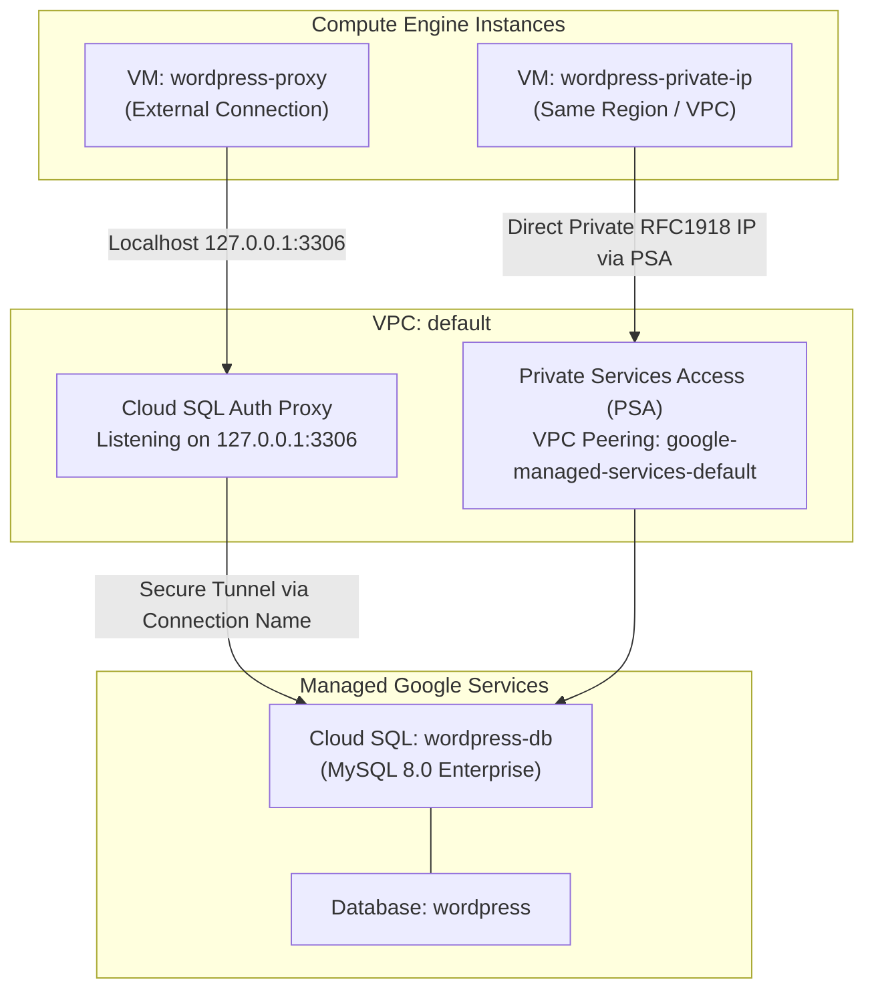

# Configure Cloud SQL (CBL037)

[](https://cloud.google.com/)
[](https://cloud.google.com/sql)
[](https://cloud.google.com/vpc/docs/private-services-access)
[](https://cloud.google.com/compute)
[](LICENSE)

Comprehensive automated solution, scripts, and documentation for the Google Cloud Skills Boost lab: **Configure Cloud SQL (CBL037)**, part of the **Essential Google Cloud Infrastructure: Core Services** course in the **Google Cloud Engineering Certificate** pathway.

---

## 📌 Lab Overview

* **Course:** Essential Google Cloud Infrastructure: Core Services
* **Badge / Pathway:** Google Cloud Engineering Certificate
* **Lab ID:** `CBL037`
* **Target Environment:** Google Cloud Console, Cloud Shell, Cloud SQL (MySQL 8.0 Enterprise), Compute Engine
* **Duration:** 45 minutes

### Key Architecture: Dual Connection Topology



---

## 🚀 Quick Start (Cloud Shell Execution)

You can run `solve.sh` interactively (the script will prompt you to enter your assigned **Region** and **Zone**, with auto-detected defaults):

```bash
git clone https://github.com/KD0-7/lab-gcec.git
cd lab-gcec/CBL037-configure-cloud-sql
chmod +x solve.sh verify.sh
./solve.sh
```

### Alternatively, pass Region and Zone directly via CLI:

```bash
# Syntax: ./solve.sh <REGION> <ZONE> [ROOT_PASSWORD]
./solve.sh us-central1 us-central1-a Password123!
```

---

## 📋 Task Breakdown & Solutions

### Task 1: Enable the Required APIs
Enable Service Networking, Cloud SQL Admin, and Compute Engine:
```bash
gcloud services enable \
    servicenetworking.googleapis.com \
    sqladmin.googleapis.com \
    compute.googleapis.com
```

---

### Task 2: Create a Cloud SQL Database
1. **Allocate Private Services Access (PSA) IP Range:**
   ```bash
   gcloud compute addresses create google-managed-services-default \
       --global \
       --purpose=VPC_PEERING \
       --prefix-length=16 \
       --description="peering range for Cloud SQL" \
       --network=default
   ```
2. **Establish VPC Peering Connection:**
   ```bash
   gcloud services vpc-peerings connect \
       --service=servicenetworking.googleapis.com \
       --ranges=google-managed-services-default \
       --network=default
   ```
3. **Provision Cloud SQL Instance (`wordpress-db`):**
   * **Instance ID:** `wordpress-db`
   * **Database Version:** `MySQL 8.0`
   * **Edition:** Enterprise
   * **Machine Tier:** 1 vCPU, 3.75 GB RAM (`db-custom-1-3840`)
   * **Storage:** 10 GB SSD
   * **Networking:** Private IP (PSA) on `default` network + Public IP assigned
   * **SSL Mode:** Allow unencrypted network traffic (`ALLOW_UNENCRYPTED_AND_ENCRYPTED`)
   
   ```bash
   gcloud sql instances create wordpress-db \
       --database-version=MYSQL_8_0 \
       --tier=db-custom-1-3840 \
       --region="<YOUR_REGION>" \
       --zone="<YOUR_ZONE>" \
       --root-password="Password123!" \
       --storage-type=SSD \
       --storage-size=10GB \
       --network=default \
       --assign-ip \
       --ssl-mode=ALLOW_UNENCRYPTED_AND_ENCRYPTED
   ```

* **Checkpoint 1:** Click **Check my progress** for **Create a Cloud SQL instance**.

---

### Task 3: Create Database & Configure Proxy on `wordpress-proxy`
1. **Create the WordPress Database:**
   ```bash
   gcloud sql databases create wordpress --instance=wordpress-db
   ```
2. **Retrieve SQL Connection Name:**
   ```bash
   SQL_CONNECTION=$(gcloud sql instances describe wordpress-db --format='value(connectionName)')
   ```
3. **Download & Start Cloud SQL Auth Proxy on `wordpress-proxy` VM:**
   ```bash
   wget https://dl.google.com/cloudsql/cloud_sql_proxy.linux.amd64 -O cloud_sql_proxy
   chmod +x cloud_sql_proxy
   ./cloud_sql_proxy -instances=$SQL_CONNECTION=tcp:3306 &
   ```
   *(Listening on `127.0.0.1:3306 for [SQL_CONNECTION_NAME] Ready for new connections`)*

* **Checkpoint 2:** Click **Check my progress** for **Create a database and configure a proxy on a Virtual Machine**.

---

### Task 4: Connect Application to Cloud SQL via Proxy
1. Get the external IP of `wordpress-proxy`:
   ```bash
   gcloud compute instances describe wordpress-proxy --zone="<PROXY_ZONE>" --format='get(networkInterfaces[0].accessConfigs[0].natIP)'
   ```
2. Open `http://<WORDPRESS_PROXY_EXTERNAL_IP>` in your web browser.
3. Click **Let's go!** and specify:
   * **Database Name:** `wordpress`
   * **Username:** `root`
   * **Password:** `Password123!` *(or your configured root password)*
   * **Database Host:** `127.0.0.1`
4. Click **Submit** -> **Run the installation**.
5. Fill out demo site info (title/username/password) and complete the WordPress setup.

---

### Task 5: Connect to Cloud SQL via Internal (Private) IP
1. Retrieve the internal/private IP of `wordpress-db`:
   ```bash
   SQL_PRIVATE_IP=$(gcloud sql instances describe wordpress-db --format='value(ipAddresses.filter(type:PRIVATE).ipAddress)')
   ```
2. Get the external IP of `wordpress-private-ip`:
   ```bash
   gcloud compute instances describe wordpress-private-ip --zone="<PRIVATE_VM_ZONE>" --format='get(networkInterfaces[0].accessConfigs[0].natIP)'
   ```
3. Open `http://<WORDPRESS_PRIVATE_IP_EXTERNAL_IP>` in your web browser.
4. Click **Let's go!** and specify:
   * **Database Name:** `wordpress`
   * **Username:** `root`
   * **Password:** `Password123!`
   * **Database Host:** `<SQL_PRIVATE_IP>`
5. Click **Submit** -> **Run the installation**.
6. The window displays **'Already Installed!'**, confirming direct private connection to the shared database.

---

## 🔍 Verification Script

Run `verify.sh` to validate your deployment status:

```bash
./verify.sh
```

---

## ✅ Score Checklist

| Checkpoint | Task Description | Verification Item | Status |
| :--- | :--- | :--- | :---: |
| **Check 1** | Task 2: Create a Cloud SQL instance | `wordpress-db` running in assigned region/zone with Private IP | Green ✔ |
| **Check 2** | Task 3: Create database & proxy | Database `wordpress` created + proxy running on `wordpress-proxy` | Green ✔ |
| **Demo 1** | Task 4: Connect via Proxy | WordPress frontend operational at `http://<WORDPRESS_PROXY_IP>` | Green ✔ |
| **Demo 2** | Task 5: Connect via Private IP | WordPress frontend connects to `<SQL_PRIVATE_IP>` directly | Green ✔ |
