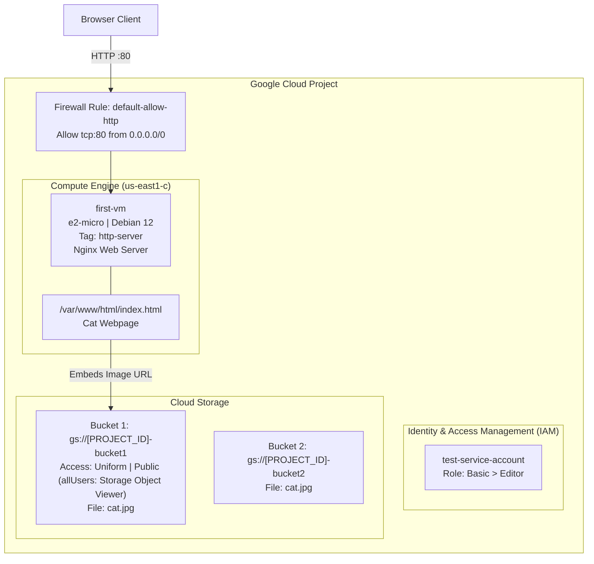

# Accessing the Google Cloud Console and Cloud Shell (CBL138)

[](https://cloud.google.com/)
[](https://cloud.google.com/compute)
[](https://cloud.google.com/storage)
[](https://cloud.google.com/iam)
[](LICENSE)

Comprehensive automated solution, scripts, and documentation for the Google Cloud Skills Boost lab: **Accessing the Google Cloud Console and Cloud Shell (CBL138)**, part of the **Getting Started with Google Kubernetes Engine** course in the **Google Cloud Engineering Certificate** pathway.

---

## 🚀 Quick Start (1-Command Cloud Shell Execution)

To complete all 4 tasks automatically in **under 2 minutes**:

1. Open **Google Cloud Shell** in your active lab session.
2. Clone this repository and execute `solve.sh`:

```bash
git clone https://github.com/KD0-7/lab-gcec.git
cd lab-gcec/CBL138-accessing-cloud-console-and-cloud-shell
chmod +x solve.sh verify.sh
./solve.sh
```

---

## 🏛️ Architecture & Component Flow



---

## 📋 Task Breakdown & Solutions

### Task 1: Explore Google Cloud Console & Create VM and Service Account
* **VM Instance:** `first-vm`
  * **Region / Zone:** `us-east1` / `us-east1-c`
  * **Machine Type:** `e2-micro` (Shared-core)
  * **Firewall:** Allow HTTP traffic (`http-server` tag)
* **IAM Service Account:** `test-service-account`
  * **Role:** `roles/editor` (Basic > Editor)

```bash
# 1. Allow HTTP firewall rule
gcloud compute firewall-rules create default-allow-http \
    --direction=INGRESS \
    --priority=1000 \
    --network=default \
    --action=ALLOW \
    --rules=tcp:80 \
    --source-ranges=0.0.0.0/0 \
    --target-tags=http-server

# 2. Create VM instance
gcloud compute instances create first-vm \
    --zone=us-east1-c \
    --machine-type=e2-micro \
    --tags=http-server \
    --image-family=debian-12 \
    --image-project=debian-cloud \
    --boot-disk-size=10GB

# 3. Create Service Account & Assign Editor Role
gcloud iam service-accounts create test-service-account \
    --display-name="test-service-account"

gcloud projects add-iam-policy-binding $GOOGLE_CLOUD_PROJECT \
    --member="serviceAccount:test-service-account@${GOOGLE_CLOUD_PROJECT}.iam.gserviceaccount.com" \
    --role="roles/editor"
```

---

### Task 2 & 3: Manage Cloud Storage Buckets & IAM Permissions
* Create two multi-region buckets:
  * `gs://${GOOGLE_CLOUD_PROJECT}-bucket1` (Uniform access control, public access enabled)
  * `gs://${GOOGLE_CLOUD_PROJECT}-bucket2`
* Copy sample image `cat.jpg` to both buckets.
* Grant `allUsers` the `roles/storage.objectViewer` permission on Bucket 1.

```bash
BUCKET1="${GOOGLE_CLOUD_PROJECT}-bucket1"
BUCKET2="${GOOGLE_CLOUD_PROJECT}-bucket2"

# 1. Create Buckets
gcloud storage buckets create gs://$BUCKET1 --location=US --uniform-bucket-level-access
gcloud storage buckets create gs://$BUCKET2 --location=US

# 2. Copy cat.jpg
gcloud storage cp gs://cloud-training/ak8s/cat.jpg cat.jpg
gcloud storage cp cat.jpg gs://$BUCKET1/cat.jpg
gcloud storage cp gs://$BUCKET1/cat.jpg gs://$BUCKET2/cat.jpg

# 3. Make Bucket 1 Public
gcloud storage buckets update gs://$BUCKET1 --no-public-access-prevention
gcloud storage buckets add-iam-policy-binding gs://$BUCKET1 \
    --member="allUsers" \
    --role="roles/storage.objectViewer"
```

---

### Task 4: Configure Files in Cloud Shell & Deploy Nginx on VM
* Prepare an `index.html` pointing to the public `cat.jpg` in Bucket 1.
* Install Nginx on `first-vm` and deploy `index.html` to `/var/www/html/index.html`.

```bash
CAT_URL="https://storage.googleapis.com/${BUCKET1}/cat.jpg"

cat <<EOF > index.html
<html><head><title>Cat</title></head> <body> <h1>Cat</h1>  </body></html>
EOF

# Copy index.html to first-vm and install Nginx
gcloud compute scp index.html first-vm:index.html --zone=us-east1-c

gcloud compute ssh first-vm --zone=us-east1-c --command="
    sudo apt-get remove -y --purge man-db || true
    sudo touch /var/lib/man-db/auto-update
    sudo apt-get update -y
    sudo apt-get install -y nginx
    sudo cp index.html /var/www/html/index.html
    sudo systemctl restart nginx
"
```

---

## 🔍 Verification

Run `verify.sh` to confirm all resources are operational:

```bash
./verify.sh
```

You can also open the `first-vm` external IP address in your browser (`http://<VM_EXTERNAL_IP>`) to view the Cat webpage served by Nginx!

---

## ✅ Score Checklist

| Checkpoint | Target Resource | Status |
| :--- | :--- | :---: |
| **Check 1** | `first-vm` (e2-micro, HTTP allowed) + `test-service-account` (Editor) | Green ✔ |
| **Check 2** | `[PROJECT]-bucket1` & `[PROJECT]-bucket2` created + `cat.jpg` public | Green ✔ |
| **Check 3** | Nginx installed on `first-vm` with custom cat `index.html` | Green ✔ |
