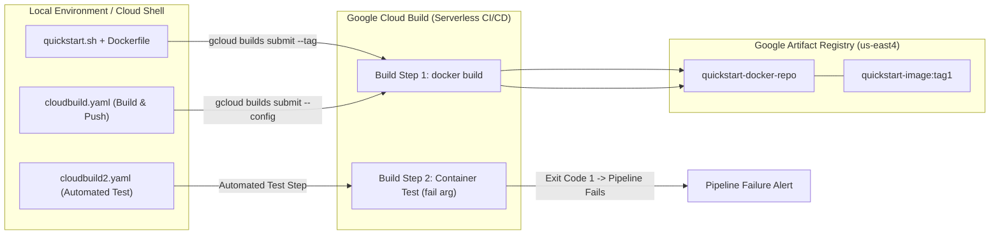

# Working with Cloud Build (CBL139)

[](https://cloud.google.com/)
[](https://cloud.google.com/build)
[](https://cloud.google.com/artifact-registry)
[](https://www.docker.com/)
[](LICENSE)

Comprehensive automated solution, scripts, and documentation for the Google Cloud Skills Boost lab: **Working with Cloud Build (CBL139)**, part of the **Getting Started with Google Kubernetes Engine** course in the **Google Cloud Engineering Certificate** pathway.

---

## 🚀 Quick Start (1-Command Cloud Shell Execution)

To execute all builds and pass both checkpoints automatically in **under 2 minutes**:

1. Open **Google Cloud Shell** in your active lab session.
2. Clone this repository and execute `solve.sh`:

```bash
git clone https://github.com/KD0-7/lab-gcec.git
cd lab-gcec/CBL139-working-with-cloud-build
chmod +x solve.sh verify.sh quickstart.sh
./solve.sh
```

---

## 🏛️ CI/CD Pipeline Architecture



---

## 📋 Task Breakdown & Solutions

### Task 1: Enable Required APIs
* `cloudbuild.googleapis.com` (Cloud Build API)
* `artifactregistry.googleapis.com` (Artifact Registry API)

```bash
gcloud services enable cloudbuild.googleapis.com artifactregistry.googleapis.com
```

---

### Task 2: Build Containers with a Dockerfile and Cloud Build
* Create Docker repository in Artifact Registry:
```bash
gcloud artifacts repositories create quickstart-docker-repo \
    --repository-format=docker \
    --location=us-east4 \
    --description="Docker repository"
```
* Create source files (`quickstart.sh` and `Dockerfile`):
```bash
cat <<'EOF' > quickstart.sh
#!/bin/sh
echo "Hello, world! The time is $(date)."
EOF
chmod +x quickstart.sh

cat <<'EOF' > Dockerfile
FROM alpine
COPY quickstart.sh /
CMD ["/quickstart.sh"]
EOF
```
* Submit build using `--tag`:
```bash
gcloud builds submit --tag us-east4-docker.pkg.dev/${DEVSHELL_PROJECT_ID}/quickstart-docker-repo/quickstart-image:tag1 .
```

---

### Task 3: Build Containers Using a Build Configuration File (`cloudbuild.yaml`)
* Define declarative build steps in `cloudbuild.yaml`:
```yaml
steps:
- name: 'gcr.io/cloud-builders/docker'
  args: [ 'build', '-t', 'us-east4-docker.pkg.dev/$PROJECT_ID/quickstart-docker-repo/quickstart-image:tag1', '.' ]
images:
- 'us-east4-docker.pkg.dev/$PROJECT_ID/quickstart-docker-repo/quickstart-image:tag1'
```
* Submit build:
```bash
gcloud builds submit --config cloudbuild.yaml .
```

---

### Task 4: Automated Container Testing & Pipeline Failure (`cloudbuild2.yaml`)
* Modify `quickstart.sh` to simulate a test assertion:
```bash
cat <<'EOF' > quickstart.sh
#!/bin/sh
if [ -z "$1" ]
then
  echo "Hello, world! The time is $(date)."
  exit 0
else
  exit 1
fi
EOF
chmod +x quickstart.sh
```
* Create `cloudbuild2.yaml` that invokes the built container with argument `fail`:
```yaml
steps:
- name: 'gcr.io/cloud-builders/docker'
  args: [ 'build', '-t', 'us-east4-docker.pkg.dev/$PROJECT_ID/quickstart-docker-repo/quickstart-image:tag1', '.' ]
- name: 'us-east4-docker.pkg.dev/$PROJECT_ID/quickstart-docker-repo/quickstart-image:tag1'
  args: ['fail']
images:
- 'us-east4-docker.pkg.dev/$PROJECT_ID/quickstart-docker-repo/quickstart-image:tag1'
```
* Execute the build and verify the pipeline reports a non-zero failure code (`echo $?`):
```bash
gcloud builds submit --config cloudbuild2.yaml .
echo $?
```

---

## 🔍 Verification

Run `verify.sh` to confirm repository contents and build logs:

```bash
./verify.sh
```

---

## ✅ Score Checklist

| Checkpoint | Target Resource | Status |
| :--- | :--- | :---: |
| **Check 1** | Build two container images in Cloud Build (Tag & `cloudbuild.yaml`) | Green ✔ |
| **Check 2** | Build and test containers with a build configuration file (`cloudbuild2.yaml`) | Green ✔ |
