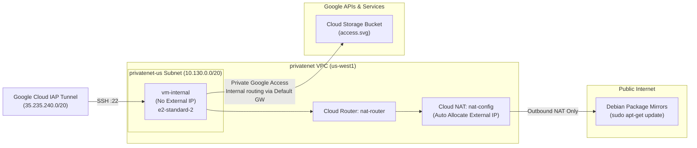

# Implement Private Google Access and Cloud NAT (CBL188)

[](https://cloud.google.com/)
[](https://cloud.google.com/nat)
[](https://cloud.google.com/compute)
[](https://cloud.google.com/storage)
[](LICENSE)

Comprehensive automated solution, scripts, and documentation for the Google Cloud Skills Boost lab: **Implement Private Google Access and Cloud NAT (CBL188)**, part of the **Essential Google Cloud Infrastructure: Foundation** course in the **Google Cloud Engineering Certificate** pathway.

---

## 🚀 Quick Start (1-Command Cloud Shell Execution)

To complete all tasks automatically in **under 2 minutes**:

1. Open **Google Cloud Shell** in your active lab session.
2. Clone this repository and execute `solve.sh`:

```bash
git clone https://github.com/KD0-7/lab-gcec.git
cd lab-gcec/CBL188-implement-private-google-access-and-cloud-nat
chmod +x solve.sh verify.sh
./solve.sh
```

---

## 🏛️ Architecture & Traffic Flow



---

## 📝 In-Lab Quiz Questions & Answers

| # | Question | Correct Answer |
| :-: | :--- | :--- |
| **1** | Did the command prompt change to `@vm-internal`? | **`True`** |
| **2** | Currently, which of your VM instances can access the image from your bucket? (Before PGA enabled) | **`Cloud Shell`** |

---

## 📋 Task Breakdown & Solutions

### Task 1: Create VPC, Subnet, Firewall Rule & Private VM
* **VPC:** `privatenet` (Custom mode)
* **Subnet:** `privatenet-us` — CIDR: `10.130.0.0/20` in `us-west1`
* **Firewall Rule:** `privatenet-allow-ssh` allowing `tcp:22` from `35.235.240.0/20` (Cloud IAP range)
* **VM Instance:** `vm-internal` in `us-west1-b` (`e2-standard-2`, Debian 12) with **no external IP address** (`--no-address`).

```bash
# 1. Create VPC & Subnet
gcloud compute networks create privatenet --subnet-mode=custom
gcloud compute networks subnets create privatenet-us \
    --network=privatenet \
    --region=us-west1 \
    --range=10.130.0.0/20

# 2. Create IAP SSH Firewall Rule
gcloud compute firewall-rules create privatenet-allow-ssh \
    --network=privatenet \
    --action=ALLOW \
    --direction=INGRESS \
    --rules=tcp:22 \
    --source-ranges=35.235.240.0/20

# 3. Create Private VM
gcloud compute instances create vm-internal \
    --zone=us-west1-b \
    --machine-type=e2-standard-2 \
    --subnet=privatenet-us \
    --no-address \
    --image-family=debian-12 \
    --image-project=debian-cloud \
    --boot-disk-size=10GB
```

---

### Task 2: Create Storage Bucket & Enable Private Google Access
* Create a Cloud Storage bucket with a globally unique name.
* Copy sample image `gs://cloud-training/gcpnet/private/access.svg` into your bucket.
* Enable **Private Google Access** on the `privatenet-us` subnet so private instances can reach Google APIs and services without public IPs.

```bash
MY_BUCKET="${GOOGLE_CLOUD_PROJECT}-pga-storage"

# Create Bucket and copy image
gcloud storage buckets create gs://$MY_BUCKET --location=US --public-access-prevention
gcloud storage cp gs://cloud-training/gcpnet/private/access.svg gs://$MY_BUCKET/

# Enable Private Google Access on Subnet
gcloud compute networks subnets update privatenet-us \
    --region=us-west1 \
    --enable-private-ip-google-access
```

---

### Task 3 & 4: Configure Cloud Router, Cloud NAT Gateway & Logging
* Create regional Cloud Router `nat-router` in `us-west1`.
* Configure Cloud NAT gateway `nat-config` to auto-allocate external IPs and map all subnet ranges.
* Enable Cloud NAT Logging (`Translation and errors`) to capture connection events in Cloud Logging.

```bash
# 1. Create Cloud Router
gcloud compute routers create nat-router \
    --network=privatenet \
    --region=us-west1

# 2. Create Cloud NAT Gateway with Logging
gcloud compute routers nats create nat-config \
    --router=nat-router \
    --region=us-west1 \
    --auto-allocate-nat-external-ips \
    --nat-all-subnet-ip-ranges \
    --enable-logging \
    --log-filter=TRANSLATION_AND_ERRORS
```

---

## 🔍 Verification

Run the verification script to confirm health and configuration:

```bash
./verify.sh
```

Or run manual test commands inside `vm-internal` via IAP tunnel:

```bash
# Test 1: Fetch from GCS using Private Google Access
gcloud compute ssh vm-internal --zone=us-west1-b --tunnel-through-iap \
    --command="gcloud storage cp gs://${GOOGLE_CLOUD_PROJECT}-pga-storage/*.svg ."

# Test 2: Update apt packages using Cloud NAT
gcloud compute ssh vm-internal --zone=us-west1-b --tunnel-through-iap \
    --command="sudo apt-get update"
```

---

## ✅ Score Checklist

| Checkpoint | Target Resource | Status |
| :--- | :--- | :---: |
| **Check 1** | `privatenet` + `privatenet-us` + `vm-internal` (No External IP) | Green ✔ |
| **Check 2** | GCS Bucket created + Private Google Access enabled on `privatenet-us` | Green ✔ |
| **Check 3** | Cloud Router `nat-router` + Cloud NAT `nat-config` running | Green ✔ |
