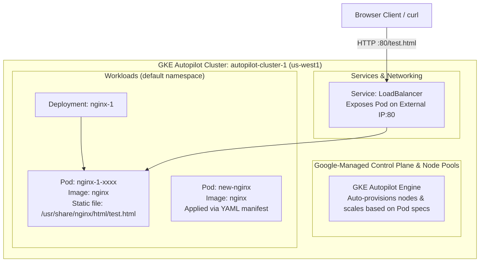

# Deploying GKE Autopilot Clusters from Cloud Shell

[](https://cloud.google.com/)
[](https://cloud.google.com/kubernetes-engine)
[](https://nginx.org/)
[](LICENSE)

Comprehensive automated solution, scripts, and documentation for the Google Cloud Skills Boost lab: **Deploying GKE Autopilot Clusters from Cloud Shell**, part of the **Getting Started with Google Kubernetes Engine** course in the **Google Cloud Engineering Certificate** pathway.

---

## 🚀 Quick Start (1-Command Cloud Shell Execution)

To complete all 5 tasks and 3 checkpoints automatically in Cloud Shell:

```bash
git clone https://github.com/KD0-7/lab-gcec.git
cd lab-gcec/GKE-autopilot-clusters-from-cloud-shell
chmod +x solve.sh verify.sh
./solve.sh
```

---

## 🏛️ GKE Autopilot Architecture



---

## 📋 Task Breakdown & Solutions

### Task 1: Deploy GKE Autopilot Cluster
* **Cluster Name:** `autopilot-cluster-1`
* **Region:** `us-west1`
* **Cluster Type:** Autopilot (`create-auto`)

```bash
export my_region=us-west1
export my_cluster=autopilot-cluster-1

gcloud container clusters create-auto $my_cluster --region $my_region
```

---

### Task 2 & 3: Connect and Inspect Kubeconfig
* Generate kubeconfig credentials:
```bash
gcloud container clusters get-credentials $my_cluster --region $my_region
```
* Inspect cluster information and contexts:
```bash
kubectl cluster-info
kubectl config current-context
kubectl config get-contexts
```

---

### Task 4: Deploy Pods, Inject Static Files & Expose LoadBalancer
* Deploy Nginx:
```bash
kubectl create deployment --image=nginx nginx-1
```
* Wait for Pod to become ready, then copy `test.html` into container:
```bash
my_nginx_pod=$(kubectl get pods -l app=nginx-1 -o jsonpath='{.items[0].metadata.name}')

cat <<EOF > ~/test.html
<header><title>This is title</title></header> Hello world
EOF

kubectl cp ~/test.html $my_nginx_pod:/usr/share/nginx/html/test.html
```
* Expose the Pod with a public LoadBalancer service:
```bash
kubectl expose pod $my_nginx_pod --port=80 --type=LoadBalancer
```

---

### Task 5: Introspect GKE Pods & Deploy via YAML Manifest
* Deploy `new-nginx` Pod using a declarative manifest:
```bash
cat <<EOF | kubectl apply -f -
apiVersion: v1
kind: Pod
metadata:
  name: new-nginx
  labels:
    name: new-nginx
spec:
  containers:
  - name: new-nginx
    image: nginx
    ports:
    - containerPort: 80
EOF
```
* Verify running status:
```bash
kubectl get pods
```

---

## 🔍 Verification

Run `verify.sh` to confirm cluster and workload status:

```bash
./verify.sh
```

---

## ✅ Score Checklist

| Checkpoint | Target Resource | Status |
| :--- | :--- | :---: |
| **Check 1** | GKE Autopilot cluster `autopilot-cluster-1` in `us-west1` | Green ✔ |
| **Check 2** | `nginx-1` Pod running + `test.html` copied + LoadBalancer service | Green ✔ |
| **Check 3** | `new-nginx` Pod deployed via YAML manifest | Green ✔ |
