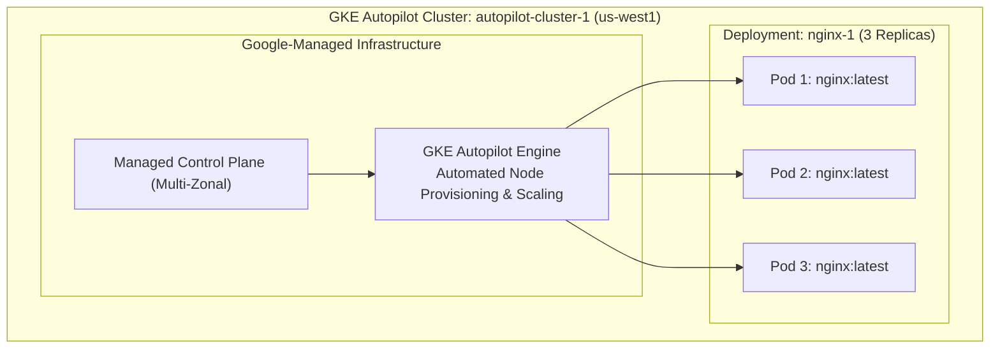

# Deploying GKE Autopilot Clusters

[](https://cloud.google.com/)
[](https://cloud.google.com/kubernetes-engine)
[](https://nginx.org/)
[](LICENSE)

Comprehensive automated solution, scripts, and documentation for the Google Cloud Skills Boost lab: **Deploying GKE Autopilot Clusters**, part of the **Getting Started with Google Kubernetes Engine** course in the **Google Cloud Engineering Certificate** pathway.

---

## 🚀 Quick Start (1-Command Cloud Shell Execution)

To complete both checkpoints automatically in Cloud Shell in **under 4 minutes**:

```bash
git clone https://github.com/KD0-7/lab-gcec.git
cd lab-gcec/GKE-deploying-autopilot-clusters
chmod +x solve.sh verify.sh
./solve.sh
```

---

## 🏛️ GKE Autopilot Architecture



---

## 📋 Task Breakdown & Solutions

### Task 1: Deploy GKE Autopilot Cluster
* **Cluster Name:** `autopilot-cluster-1`
* **Region:** `us-west1`
* **Mode:** Autopilot

#### Option A: 1-Click via Cloud Shell CLI
```bash
gcloud container clusters create-auto autopilot-cluster-1 --region us-west1
```

#### Option B: Via Google Cloud Console (GUI)
1. Go to **Navigation Menu (☰)** > **Kubernetes Engine** > **Clusters**.
2. Click **Create** > **Let's get started** on the Autopilot option.
3. **Cluster name:** `autopilot-cluster-1`
4. **Region:** `us-west1`
5. Leave all other settings at default and click **Create**.

---

### Task 2: Deploy Sample Workload
* **Deployment Name:** `nginx-1`
* **Container Image:** `nginx:latest`
* **Replicas:** 3 Pods

#### Option A: Via Cloud Shell CLI
```bash
gcloud container clusters get-credentials autopilot-cluster-1 --region us-west1
kubectl create deployment nginx-1 --image=nginx:latest --replicas=3
kubectl rollout status deployment/nginx-1
```

#### Option B: Via Google Cloud Console (GUI)
1. Go to **Kubernetes Engine** > **Workloads**.
2. Click **Create deployment**.
3. **Deployment name:** `nginx-1`
4. Keep the default image `nginx:latest`.
5. Click **Deploy**.

---

### Task 3: Inspect Workload Details in Console
1. In **Kubernetes Engine** > **Workloads**, click on `nginx-1`.
2. Inspect the **Details**, **Revision History**, **Events**, and **YAML** tabs.
3. Scroll to **Managed Pods**, click on any Pod, and inspect the container logs and specification.

---

## 🔍 Verification

Run `verify.sh` to confirm cluster and workload status:

```bash
./verify.sh
```

---

## ✅ Score Checklist

| Checkpoint | Target Resource | Status |
| :--- | :--- | :---: |
| **Check 1** | GKE Autopilot cluster `autopilot-cluster-1` in `us-west1` | Green ✔ |
| **Check 2** | Workload `nginx-1` running (3 Pod replicas, `nginx:latest`) | Green ✔ |
