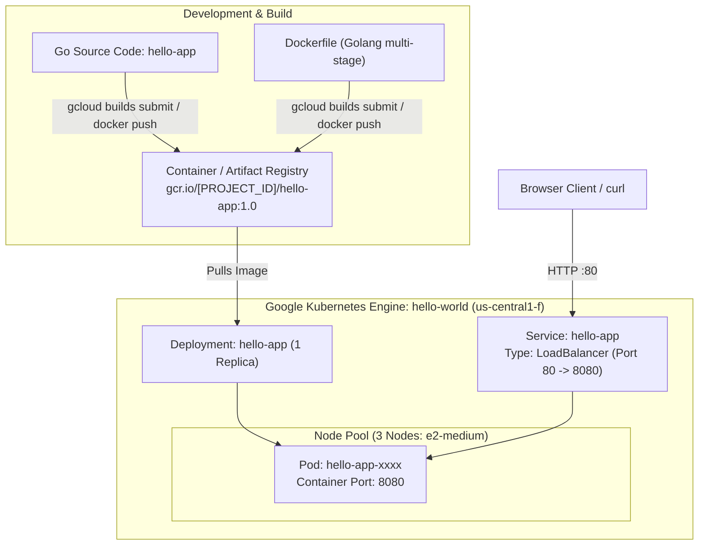

# Running a Containerized App on Google Kubernetes Engine (GSP015)

[](https://cloud.google.com/)
[](https://cloud.google.com/kubernetes-engine)
[](https://www.docker.com/)
[](https://cloud.google.com/artifact-registry)
[](LICENSE)

Comprehensive automated solution, scripts, and documentation for the Google Cloud Skills Boost lab: **Running a Containerized App on Google Kubernetes Engine (GSP015)**, part of the **Getting Started with Google Kubernetes Engine** course in the **Google Cloud Engineering Certificate** pathway.

---

## 🚀 Quick Start (1-Command Cloud Shell Execution)

To build, push, deploy, and expose the application automatically in **under 2 minutes**:

1. Open **Google Cloud Shell** in your active lab session.
2. Clone this repository and execute `solve.sh`:

```bash
git clone https://github.com/KD0-7/lab-gcec.git
cd lab-gcec/GSP015-running-a-containerized-app-on-gke
chmod +x solve.sh verify.sh
./solve.sh
```

---

## 🏛️ Application Architecture & Deployment Flow



---

## 📝 In-Lab Quiz Questions & Answers

| # | Question | Correct Answer |
| :-: | :--- | :--- |
| **1** | `docker push` publish the container image in Google Cloud to ____. | **`Artifact Registry`** (or Container Registry) |
| **2** | Kubernetes is an open-source container-orchestration system for automating deployment, scaling and management of containerized applications. | **`True`** |
| **3** | In Kubernetes environment, `kubectl expose` creates a ____, the forwarding rules for the load balancer, and the firewall rules that allow external traffic to be sent to the pod. | **`Service`** |

---

## 📋 Task Breakdown & Solutions

### Task 1: Create a Kubernetes Cluster
* **Zone:** `us-central1-f`
* **Cluster Name:** `hello-world`
* **Node Count:** 3 nodes (`e2-medium`)

```bash
gcloud config set compute/zone us-central1-f
gcloud container clusters create hello-world --num-nodes=3 --machine-type=e2-medium
gcloud container clusters get-credentials hello-world --zone=us-central1-f
```

---

### Task 2 & 3: Build and Publish the Hello World App
* Clone the sample code:
```bash
git clone https://github.com/GoogleCloudPlatform/kubernetes-engine-samples
cd kubernetes-engine-samples/quickstarts/hello-app
```
* Build and push container to Google Container / Artifact Registry:
```bash
IMAGE_TAG="gcr.io/${DEVSHELL_PROJECT_ID}/hello-app:1.0"
gcloud builds submit --tag "$IMAGE_TAG" .
```

---

### Task 4: Deploy the App & Expose via LoadBalancer
* Deploy the application:
```bash
kubectl create deployment hello-app --image=gcr.io/${DEVSHELL_PROJECT_ID}/hello-app:1.0
```
* Expose the deployment to the internet using a Google Cloud Network Load Balancer:
```bash
kubectl expose deployment hello-app --name=hello-app --type=LoadBalancer --port=80 --target-port=8080
```
* Inspect service to retrieve public external IP:
```bash
kubectl get service hello-app
```
* Test HTTP response:
```bash
curl http://<EXTERNAL_IP>
```

---

## 🔍 Verification

Run `verify.sh` to confirm cluster, deployment, and service health:

```bash
./verify.sh
```

---

## ✅ Score Checklist

| Checkpoint | Target Resource | Score | Status |
| :--- | :--- | :---: | :---: |
| **Check 1** | Create a Kubernetes Cluster (`hello-world`, 3 nodes) | 5 / 5 | Green ✔ |
| **Check 2** | Build and Deploy Hello World App (`hello-app` deployment) | 5 / 5 | Green ✔ |
| **Check 3** | Allow external traffic to `hello-app` deployment (LoadBalancer) | 5 / 5 | Green ✔ |
| **Total** | | **15 / 15** | **100% Complete** |
