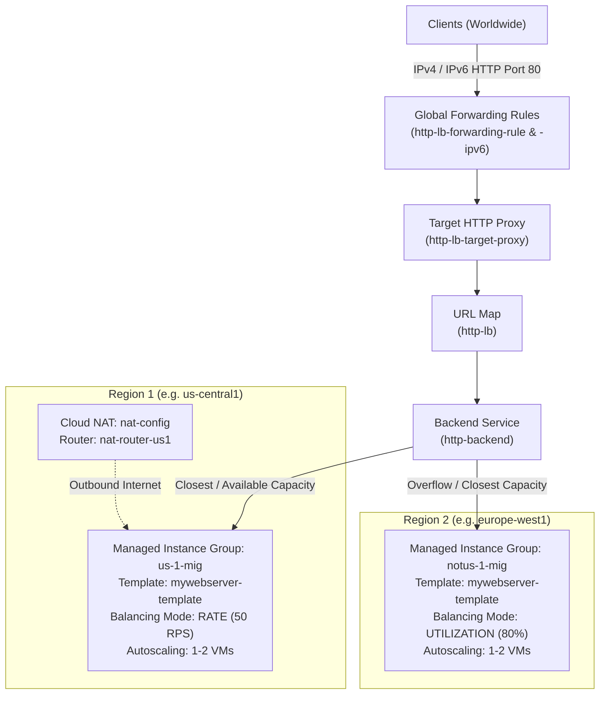

# Configure an Application Load Balancer with Autoscaling (OCBL105)

[](https://cloud.google.com/)
[](https://cloud.google.com/load-balancing)
[](https://cloud.google.com/compute)
[](https://cloud.google.com/nat)
[](LICENSE)

Comprehensive automated solution, verification script, and documentation for the Google Cloud Skills Boost lab: **Configure an Application Load Balancer with Autoscaling (OCBL105)**, part of the **Elastic Google Cloud Infrastructure: Scaling and Automation** course in the **Google Cloud Engineering Certificate** pathway.

---

## 📌 Lab Overview

* **Course:** Elastic Google Cloud Infrastructure: Scaling and Automation
* **Badge / Pathway:** Google Cloud Engineering Certificate
* **Lab ID:** `OCBL105`
* **Target Environment:** Compute Engine, Managed Instance Groups, Cloud NAT, Global External Application Load Balancer (IPv4 & IPv6)
* **Duration:** 1 hour

### Architecture & Global Traffic Topology



---

## 🚀 Quick Start (1-Command Cloud Shell Execution)

Run `solve.sh` in **Google Cloud Shell**. The script will prompt you for your assigned **Region 1**, **Zone 1**, and **Region 2**:

```bash
git clone https://github.com/KD0-7/lab-gcec.git
cd lab-gcec/OCBL105-configure-application-load-balancer-with-autoscaling
chmod +x solve.sh verify.sh
./solve.sh
```

### Alternatively, pass your regions and zone directly via CLI:

```bash
# Syntax: ./solve.sh <REGION_1> <ZONE_1> <REGION_2>
./solve.sh us-central1 us-central1-a europe-west1
```

---

## 📝 In-Lab Assessment Question & Exact Answer

When prompted on the lab instructions panel:

* **Question:** *The Application Load Balancer (HTTP) should forward traffic to the region that is closest to you.*  
  👉 **Answer:** **`True`**

---

## 📋 Step-by-Step Task Breakdown

### Task 1: Configure Health Check Firewall Rule
Allow Google Cloud health check probes from `130.211.0.0/22` and `35.191.0.0/16` on port 80:
```bash
gcloud compute firewall-rules create fw-allow-health-checks \
    --network=default \
    --action=ALLOW \
    --direction=INGRESS \
    --target-tags=allow-health-checks \
    --source-ranges=130.211.0.0/22,35.191.0.0/16 \
    --rules=tcp:80
```

---

### Task 2: Create Cloud NAT Configuration using Cloud Router
Enable outbound internet connectivity for private backend VMs in **Region 1**:
```bash
gcloud compute routers create nat-router-us1 \
    --network=default \
    --region="<REGION_1>"

gcloud compute routers nats create nat-config \
    --router=nat-router-us1 \
    --region="<REGION_1>" \
    --auto-allocate-nat-external-ips \
    --nat-all-subnet-ip-ranges
```

---

### Task 3: Create Custom Image for Web Server
1. Create temporary VM `webserver` without external IP:
   ```bash
   gcloud compute instances create webserver \
       --zone="<ZONE_1>" \
       --machine-type=e2-micro \
       --network=default \
       --tags=allow-health-checks \
       --no-address \
       --metadata=startup-script='#!/bin/bash
   apt-get update
   apt-get install -y apache2
   systemctl start apache2
   systemctl enable apache2
   '
   ```
2. Stop and delete VM keeping the boot disk:
   ```bash
   gcloud compute instances stop webserver --zone="<ZONE_1>"
   gcloud compute instances delete webserver --zone="<ZONE_1>" --keep-disks=boot
   ```
3. Create custom image `mywebserver`:
   ```bash
   gcloud compute images create mywebserver \
       --source-disk=webserver \
       --source-disk-zone="<ZONE_1>"
   ```

---

### Task 4: Configure Instance Template & Managed Instance Groups (MIGs)
1. **Instance Template:**
   ```bash
   gcloud compute instance-templates create mywebserver-template \
       --machine-type=e2-micro \
       --image=mywebserver \
       --network=default \
       --tags=allow-health-checks \
       --no-address
   ```
2. **HTTP Health Check:**
   ```bash
   gcloud compute health-checks create http http-health-check --port=80
   ```
3. **MIG 1 in Region 1 (`us-1-mig`):**
   ```bash
   gcloud compute instance-groups managed create us-1-mig \
       --region="<REGION_1>" \
       --template=mywebserver-template \
       --size=1

   gcloud compute instance-groups set-named-ports us-1-mig \
       --named-ports http:80 \
       --region="<REGION_1>"

   gcloud compute instance-groups managed set-autoscaling us-1-mig \
       --region="<REGION_1>" \
       --min-num-replicas=1 \
       --max-num-replicas=2 \
       --scale-based-on-load-balancing \
       --target-load-balancing-utilization=0.8 \
       --cool-down-period=60

   gcloud compute instance-groups managed update us-1-mig \
       --region="<REGION_1>" \
       --health-check=http-health-check \
       --initial-delay=60
   ```
4. **MIG 2 in Region 2 (`notus-1-mig`):**
   ```bash
   gcloud compute instance-groups managed create notus-1-mig \
       --region="<REGION_2>" \
       --template=mywebserver-template \
       --size=1

   gcloud compute instance-groups set-named-ports notus-1-mig \
       --named-ports http:80 \
       --region="<REGION_2>"

   gcloud compute instance-groups managed set-autoscaling notus-1-mig \
       --region="<REGION_2>" \
       --min-num-replicas=1 \
       --max-num-replicas=2 \
       --scale-based-on-load-balancing \
       --target-load-balancing-utilization=0.8 \
       --cool-down-period=60

   gcloud compute instance-groups managed update notus-1-mig \
       --region="<REGION_2>" \
       --health-check=http-health-check \
       --initial-delay=60
   ```

---

### Task 5: Configure Application Load Balancer (HTTP)
1. **Backend Service (`http-backend`):**
   ```bash
   gcloud compute backend-services create http-backend \
       --protocol=HTTP \
       --port-name=http \
       --health-checks=http-health-check \
       --global \
       --enable-logging \
       --logging-sample-rate=1.0

   gcloud compute backend-services add-backend http-backend \
       --instance-group=us-1-mig \
       --instance-group-region="<REGION_1>" \
       --balancing-mode=RATE \
       --max-rate-per-instance=50 \
       --capacity-scaler=1.0 \
       --global

   gcloud compute backend-services add-backend http-backend \
       --instance-group=notus-1-mig \
       --instance-group-region="<REGION_2>" \
       --balancing-mode=UTILIZATION \
       --max-utilization=0.8 \
       --capacity-scaler=1.0 \
       --global
   ```
2. **URL Map, Target Proxy & Forwarding Rules:**
   ```bash
   gcloud compute url-maps create http-lb --default-service=http-backend
   gcloud compute target-http-proxies create http-lb-target-proxy --url-map=http-lb

   # IPv4
   gcloud compute forwarding-rules create http-lb-forwarding-rule \
       --global \
       --target-http-proxy=http-lb-target-proxy \
       --ports=80

   # IPv6
   gcloud compute forwarding-rules create http-lb-forwarding-rule-ipv6 \
       --global \
       --target-http-proxy=http-lb-target-proxy \
       --ports=80 \
       --ip-version=IPV6
   ```

---

### Task 6: Stress Test the Load Balancer
1. Create VM `stress-test` in `<ZONE_1>`:
   ```bash
   gcloud compute instances create stress-test \
       --zone="<ZONE_1>" \
       --machine-type=e2-micro \
       --image=mywebserver
   ```
2. Run ApacheBench on the load balancer IP:
   ```bash
   ab -n 500000 -c 1000 http://<LB_IP_V4>/
   ```

---

## 🔍 Verification Script

To verify all resources and forwarders:

```bash
./verify.sh
```

---

## ✅ Score Checklist

| Checkpoint | Task Description | Verification Item | Status |
| :--- | :--- | :--- | :---: |
| **Check 1** | Configure health check firewall rule | `fw-allow-health-checks` created | Green ✔ |
| **Check 2** | Create NAT configuration using Cloud Router | `nat-router-us1` & `nat-config` in Region 1 | Green ✔ |
| **Check 3** | Create custom image for web server | `mywebserver` created from `webserver` disk | Green ✔ |
| **Check 4** | Configure instance template and instance groups | `us-1-mig` (Region 1) & `notus-1-mig` (Region 2) | Green ✔ |
| **Check 5** | Configure Application Load Balancer (HTTP) | `http-lb` with IPv4 and IPv6 frontends | Green ✔ |
| **Check 6** | Stress test Application Load Balancer | `stress-test` VM launched & traffic routed | Green ✔ |
