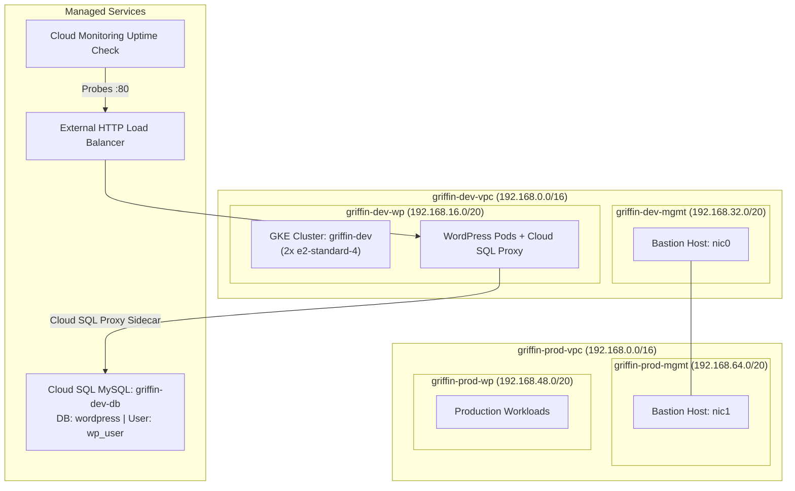

# Google Cloud Engineering Certificate (GCEC) - Hands-on Labs & Solutions

[](https://cloud.google.com/)
[](https://kubernetes.io/)
[](https://cloud.google.com/marketplace)
[](LICENSE)

A curated collection of automated solutions, scripts, architectural blueprints, and walkthroughs for the **Google Cloud Engineering Certificate** pathway on **Google Cloud Skills Boost / Qwiklabs**.

---

## 📚 Labs in this Repository

| Lab ID | Lab Title | Course / Badge | Solution & Guide |
| :--- | :--- | :--- | :---: |
| **GSP321** | **Develop your Google Cloud Network: Challenge Lab** | Develop Your Google Cloud Network | [View Solution](#-gsp321-develop-your-google-cloud-network-challenge-lab) |
| **CBL011** | **Deploy a LAMP Stack with Google Cloud Marketplace** | Essential Google Cloud Infrastructure: Foundation | [View Solution](./CBL011-deploy-lamp-stack-marketplace) |

---

## 🌟 CBL011: Deploy a LAMP Stack with Google Cloud Marketplace

* **Directory:** [`./CBL011-deploy-lamp-stack-marketplace`](./CBL011-deploy-lamp-stack-marketplace)
* **Goal:** Launch a click-to-deploy LAMP Stack (Linux, Apache, MySQL, PHP) via Google Cloud Marketplace on Compute Engine.
* **Key Configurations:**
  * **Solution:** LAMP Stack, by Google Click to Deploy
  * **Zone:** `europe-west1-b`
  * **Machine Type:** `e2-medium` (Series E2)
  * **Quiz Answer:** `Deployment Manager`
* **Verification:** Run `./verify.sh` in Cloud Shell or visit `http://<EXTERNAL_IP>`.

---

## 🌟 GSP321: Develop your Google Cloud Network: Challenge Lab

### 🚀 Quick Start (1-Command Cloud Shell Execution)

To complete all 9 tasks of GSP321 automatically in **under 5 minutes**:

```bash
git clone https://github.com/KD0-7/lab-gcec.git
cd lab-gcec
chmod +x solve.sh scripts/*.sh
./solve.sh
```

> **Tip:** You will be prompted for **Username 2** (Additional Engineer email for Task 9). You can also provide it directly:
> ```bash
> ./solve.sh "<USERNAME_2_EMAIL>"
> ```

### 🏛️ Network Architecture & Topology



### 📋 GSP321 Task Breakdown

| Task | Target Resource | Key Configuration |
| :--- | :--- | :--- |
| **Task 1** | Development VPC | `griffin-dev-vpc` with subnets `griffin-dev-wp` (`192.168.16.0/20`) & `griffin-dev-mgmt` (`192.168.32.0/20`) |
| **Task 2** | Production VPC | `griffin-prod-vpc` with subnets `griffin-prod-wp` (`192.168.48.0/20`) & `griffin-prod-mgmt` (`192.168.64.0/20`) |
| **Task 3** | Bastion Host | `griffin-bastion` (`e2-medium`) with `nic0` on dev and `nic1` on prod, plus port 22 SSH firewall rules |
| **Task 4** | Cloud SQL | MySQL instance `griffin-dev-db` in `us-east1`, database `wordpress`, user `wp_user` (`stormwind_rules`) |
| **Task 5** | GKE Cluster | 2-node cluster `griffin-dev` (`e2-standard-4`) in `griffin-dev-wp` subnet (`us-east1-c`) |
| **Task 6** | Cluster Preparation | Secrets and volume from `wp-env.yaml` + `cloudsql-instance-credentials` service account key |
| **Task 7** | WordPress Deployment | Injects Cloud SQL connection into `wp-deployment.yaml`, creates `wp-service.yaml` Load Balancer |
| **Task 8** | Cloud Monitoring | HTTP Uptime Check configured on the Load Balancer IP |
| **Task 9** | Additional Access | Grants `roles/editor` to Username 2 |

---

## 📁 Repository Structure

```
lab-gcec/
├── README.md                                   # Master repository documentation
├── solve.sh                                    # GSP321: All-in-one automated solution script
├── .gitattributes                              # Enforces LF line endings for Linux/Cloud Shell
├── .gitignore                                  # Git ignore for keys and temporary credentials
├── CBL011-deploy-lamp-stack-marketplace/       # Lab CBL011: Deploy a LAMP Stack with Marketplace
│   ├── README.md                               # Step-by-step console guide & quiz answer
│   └── verify.sh                               # Health check & Apache verification script
└── scripts/                                    # GSP321 modular task scripts
    ├── 01_dev_vpc.sh
    ├── 02_prod_vpc.sh
    ├── 03_bastion.sh
    ├── 04_cloud_sql.sh
    ├── 05_gke_cluster.sh
    ├── 06_wp_secrets.sh
    ├── 07_wp_deployment.sh
    ├── 08_monitoring.sh
    └── 09_iam_access.sh
```
