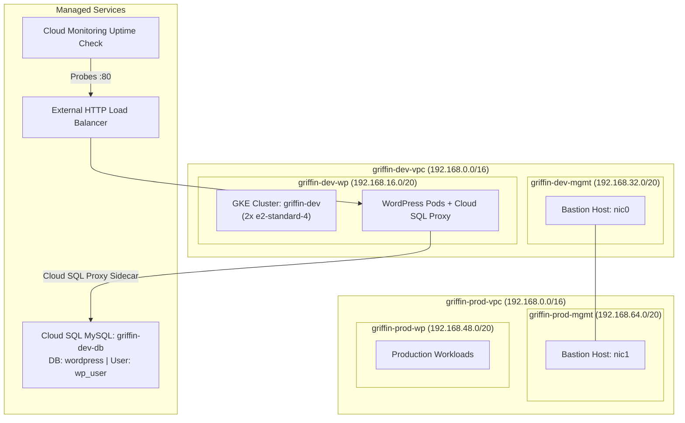

# Develop Your Google Cloud Network: Challenge Lab (GSP321)

[](https://cloud.google.com/)
[](https://kubernetes.io/)
[](https://cloud.google.com/sql)
[](LICENSE)

Comprehensive automated solution, scripts, and documentation for the Google Cloud Skills Boost Challenge Lab: **Develop your Google Cloud Network: Challenge Lab (GSP321)**, part of the **Google Cloud Engineering Certificate** pathway.

---

## 🚀 Quick Start (1-Command Cloud Shell Execution)

To complete all 9 tasks automatically in **under 5 minutes** (with concurrent execution for Cloud SQL and GKE):

1. Open **Google Cloud Shell** in your lab session.
2. Clone this repository and run `solve.sh`:

```bash
git clone https://github.com/KD0-7/lab-gcec.git
cd lab-gcec
chmod +x solve.sh scripts/*.sh
./solve.sh
```

> **Tip:** You will be prompted to enter **Username 2** (Additional Engineer email) for Task 9. You can also supply it directly as an argument:
> ```bash
> ./solve.sh "<USERNAME_2_EMAIL>"
> ```

---

## 🏛️ Network Architecture & Topology



---

## 📋 Task Breakdown & Solutions

### Task 1: Create Development VPC Manually
* **VPC Name:** `griffin-dev-vpc` (Custom mode)
* **Subnets:**
  * `griffin-dev-wp` — CIDR: `192.168.16.0/20` (`us-east1`)
  * `griffin-dev-mgmt` — CIDR: `192.168.32.0/20` (`us-east1`)

```bash
gcloud compute networks create griffin-dev-vpc --subnet-mode=custom

gcloud compute networks subnets create griffin-dev-wp \
    --network=griffin-dev-vpc \
    --region=us-east1 \
    --range=192.168.16.0/20

gcloud compute networks subnets create griffin-dev-mgmt \
    --network=griffin-dev-vpc \
    --region=us-east1 \
    --range=192.168.32.0/20
```

---

### Task 2: Create Production VPC Manually
* **VPC Name:** `griffin-prod-vpc` (Custom mode)
* **Subnets:**
  * `griffin-prod-wp` — CIDR: `192.168.48.0/20` (`us-east1`)
  * `griffin-prod-mgmt` — CIDR: `192.168.64.0/20` (`us-east1`)

```bash
gcloud compute networks create griffin-prod-vpc --subnet-mode=custom

gcloud compute networks subnets create griffin-prod-wp \
    --network=griffin-prod-vpc \
    --region=us-east1 \
    --range=192.168.48.0/20

gcloud compute networks subnets create griffin-prod-mgmt \
    --network=griffin-prod-vpc \
    --region=us-east1 \
    --range=192.168.64.0/20
```

---

### Task 3: Create Bastion Host
* **Instance Name:** `griffin-bastion`
* **Zone:** `us-east1-c`
* **Machine Type:** `e2-medium`
* **Interfaces:**
  * `nic0`: `griffin-dev-mgmt`
  * `nic1`: `griffin-prod-mgmt`
* **Firewall Rules:** Allow incoming SSH (port 22) on both networks.

```bash
gcloud compute firewall-rules create griffin-dev-allow-ssh \
    --network=griffin-dev-vpc \
    --allow=tcp:22 \
    --source-ranges=0.0.0.0/0

gcloud compute firewall-rules create griffin-prod-allow-ssh \
    --network=griffin-prod-vpc \
    --allow=tcp:22 \
    --source-ranges=0.0.0.0/0

gcloud compute instances create griffin-bastion \
    --zone=us-east1-c \
    --machine-type=e2-medium \
    --tags=ssh,bastion \
    --network-interface=subnet=griffin-dev-mgmt \
    --network-interface=subnet=griffin-prod-mgmt
```

---

### Task 4: Create and Configure Cloud SQL Instance
* **Instance Name:** `griffin-dev-db`
* **Database Engine:** MySQL
* **Region:** `us-east1`
* **Database:** `wordpress`
* **User:** `wp_user` / `stormwind_rules`

```bash
gcloud sql instances create griffin-dev-db \
    --database-version=MYSQL_5_7 \
    --region=us-east1 \
    --tier=db-n1-standard-1 \
    --root-password=password

gcloud sql databases create wordpress --instance=griffin-dev-db
gcloud sql users create wp_user --host="%" --instance=griffin-dev-db --password=stormwind_rules
```

---

### Task 5: Create Kubernetes Cluster
* **Cluster Name:** `griffin-dev`
* **Zone:** `us-east1-c`
* **Node Count:** 2 nodes (`e2-standard-4`)
* **Network / Subnet:** `griffin-dev-vpc` / `griffin-dev-wp`

```bash
gcloud container clusters create griffin-dev \
    --zone=us-east1-c \
    --num-nodes=2 \
    --machine-type=e2-standard-4 \
    --network=griffin-dev-vpc \
    --subnetwork=griffin-dev-wp

gcloud container clusters get-credentials griffin-dev --zone=us-east1-c
```

---

### Task 6: Prepare the Kubernetes Cluster
* Copy manifests from `gs://spls/gsp321/wp-k8s`
* Update `wp-env.yaml` credentials to `wp_user` and `stormwind_rules`
* Generate service account key for `cloud-sql-proxy` sidecar and create secret `cloudsql-instance-credentials`

```bash
mkdir -p ~/wp-k8s && cd ~/wp-k8s
gsutil cp -r gs://spls/gsp321/wp-k8s/* .

sed -i 's/username_goes_here/wp_user/g' wp-env.yaml
sed -i 's/password_goes_here/stormwind_rules/g' wp-env.yaml
kubectl apply -f wp-env.yaml

gcloud iam service-accounts keys create key.json \
    --iam-account=cloud-sql-proxy@$GOOGLE_CLOUD_PROJECT.iam.gserviceaccount.com

kubectl create secret generic cloudsql-instance-credentials --from-file=key.json
```

---

### Task 7: Create a WordPress Deployment
* Replace `YOUR_SQL_INSTANCE` in `wp-deployment.yaml` with the Cloud SQL connection string: `<PROJECT_ID>:us-east1:griffin-dev-db`
* Apply deployment and service:

```bash
cd ~/wp-k8s
INSTANCE_NAME=$(gcloud sql instances describe griffin-dev-db --format='value(connectionName)')
sed -i "s/YOUR_SQL_INSTANCE/${INSTANCE_NAME}/g" wp-deployment.yaml

kubectl apply -f wp-deployment.yaml
kubectl apply -f wp-service.yaml
```

---

### Task 8: Enable Monitoring
* Create an HTTP Uptime Check for the WordPress frontend Load Balancer IP:

```bash
WP_IP=$(kubectl get svc -o jsonpath='{.items[?(@.spec.type=="LoadBalancer")].status.loadBalancer.ingress[0].ip}')
TOKEN=$(gcloud auth print-access-token)

curl -X POST \
  -H "Authorization: Bearer $TOKEN" \
  -H "Content-Type: application/json" \
  -d '{
    "displayName": "WordPress Uptime",
    "monitoredResource": {
      "type": "uptime_url",
      "labels": {
        "project_id": "'"$GOOGLE_CLOUD_PROJECT"'",
        "host": "'"$WP_IP"'"
      }
    },
    "httpCheck": {
      "path": "/",
      "port": 80,
      "useSsl": false
    },
    "period": "60s"
  }' \
  "https://monitoring.googleapis.com/v3/projects/$GOOGLE_CLOUD_PROJECT/uptimeCheckConfigs"
```

*Manual alternative via Google Cloud Console:*
1. Navigate to **Monitoring** > **Uptime checks** > **+ Create Uptime Check**.
2. **Title:** `WordPress Uptime`
3. **Protocol:** `HTTP`
4. **Resource Type:** `URL`
5. **Hostname:** `<WORDPRESS_EXTERNAL_IP>`
6. **Path:** `/`
7. Click **Create**.

---

### Task 9: Provide Access for an Additional Engineer
* Grant the secondary lab user (Username 2) the **Editor** role:

```bash
gcloud projects add-iam-policy-binding $GOOGLE_CLOUD_PROJECT \
    --member="user:<USERNAME_2_EMAIL>" \
    --role="roles/editor"
```

---

## 📁 Repository Structure

```
lab-gcec/
├── README.md                 # Detailed challenge lab guide & walkthrough
├── solve.sh                  # Master all-in-one automated solution script
├── .gitignore                # Git ignore for keys and temporary credentials
└── scripts/
    ├── 01_dev_vpc.sh         # Task 1: Dev VPC and subnets
    ├── 02_prod_vpc.sh        # Task 2: Prod VPC and subnets
    ├── 03_bastion.sh         # Task 3: Dual-NIC Bastion and firewall rules
    ├── 04_cloud_sql.sh       # Task 4: Cloud SQL MySQL instance and credentials
    ├── 05_gke_cluster.sh     # Task 5: 2-Node GKE cluster
    ├── 06_wp_secrets.sh      # Task 6: WordPress secrets and SA key
    ├── 07_wp_deployment.sh   # Task 7: WordPress deployment and service
    ├── 08_monitoring.sh      # Task 8: Cloud Monitoring Uptime Check
    └── 09_iam_access.sh      # Task 9: Additional engineer IAM role
```

---

## ✅ Verification Checklist

| Task | Target Resource | Status |
| :--- | :--- | :---: |
| **Task 1** | `griffin-dev-vpc` with `griffin-dev-wp` & `griffin-dev-mgmt` | Green ✔ |
| **Task 2** | `griffin-prod-vpc` with `griffin-prod-wp` & `griffin-prod-mgmt` | Green ✔ |
| **Task 3** | `griffin-bastion` dual-NIC host + SSH firewall rules | Green ✔ |
| **Task 4** | `griffin-dev-db` MySQL instance + `wordpress` DB + `wp_user` | Green ✔ |
| **Task 5** | `griffin-dev` 2-node cluster in `griffin-dev-wp` (`us-east1-c`) | Green ✔ |
| **Task 6** | `wp-env.yaml` secrets + `cloudsql-instance-credentials` | Green ✔ |
| **Task 7** | `wp-deployment` running + `wp-service` Load Balancer | Green ✔ |
| **Task 8** | `WordPress Uptime` check active on Load Balancer IP | Green ✔ |
| **Task 9** | Username 2 granted `roles/editor` | Green ✔ |
